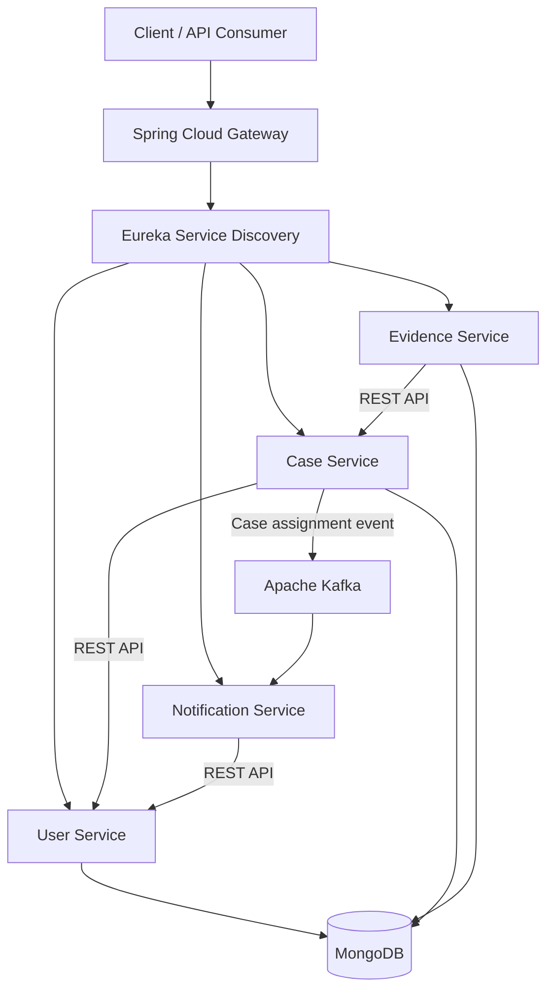

# CCIMS — Cyber Crime Case Investigation Management System

A microservices-based backend application designed to support cybercrime investigation workflows, including user management, case assignment, digital evidence management, and event-driven notifications.

## Overview

CCIMS (Cyber Crime Case Investigation Management System) is a personal project built with Java and Spring Boot. It demonstrates microservices architecture, distributed service communication, JWT-based authentication, role-based authorization, asynchronous messaging, and containerized deployment.

## Architecture



### Microservices

| Service | Responsibility | Port |
|---|---|---:|
| API Gateway | Entry point for client requests and service routing | 8085 |
| User Service | User management and authentication | 8080 |
| Case Service | Case management and investigator assignment | 8081 |
| Evidence Service | Evidence upload and case validation | 8082 |
| Notification Service | Processes case assignment events and manages notifications | 8083 |
| Eureka Server | Service registration and discovery | 8761 |
| MongoDB | Persistent storage for application data | 27018 on host |
| Apache Kafka | Asynchronous event messaging | 9094 on host |

Inside the Docker network, MongoDB uses port `27017` and Kafka uses port `9092`.

## Features

- **Authentication and authorization:** JWT authentication with role-based access control for `ADMIN`, `INVESTIGATOR`, and `ANALYST`.
- **User management:** Create, retrieve, update, and delete users according to access permissions.
- **Case management:** Create, retrieve, update, and delete investigation cases.
- **Case assignment:** Assign cases to investigators and track assignment information.
- **Evidence management:** Upload evidence files associated with cases and maintain evidence metadata.
- **Service-to-service communication:** REST-based communication between microservices using Spring Cloud LoadBalancer and Eureka.
- **Event-driven processing:** Publish case assignment events through Apache Kafka for asynchronous notification processing.
- **Fault tolerance:** Resilience4j Circuit Breaker with fallback handling for Evidence Service calls to Case Service.
- **Centralized API entry point:** Route client requests through Spring Cloud Gateway.
- **Containerization:** Docker images and Docker Compose configuration for running the distributed application locally.
- **Continuous Integration:** GitHub Actions workflow for automated Maven builds.

## Technology Stack

| Category | Technologies |
|---|---|
| Language | Java |
| Backend | Spring Boot, Spring Security |
| APIs | REST API, Spring Cloud Gateway |
| Service Discovery | Netflix Eureka |
| Load Balancing | Spring Cloud LoadBalancer |
| Messaging | Apache Kafka |
| Database | MongoDB |
| Resilience | Resilience4j |
| Build Tool | Maven |
| Containers | Docker, Docker Compose |
| CI | GitHub Actions |

## Project Structure

```text
CCIMS/
├── .github/
│   └── workflows/
│       └── ci.yml
├── common/
├── user-service/
├── case-service/
├── evidence-service/
├── notification-service/
├── eureka-server/
├── gateway-service/
├── docker-compose-dev.yml
├── docker-compose.yml
└── pom.xml
```

The `common` module contains shared components used across services. The root `pom.xml` manages the multi-module Maven build.

## Getting Started

### Prerequisites

- Java 21 or a compatible configured JDK
- Maven
- Docker Desktop with Docker Compose
- Git

### 1. Clone the repository

```bash
git clone -b microservices https://github.com/Ishan2000-ace/CCIMS.git
cd CCIMS
```

### 2. Build the Maven project

```bash
mvn clean package -DskipTests
```

### 3. Build the Docker images

After the Maven build succeeds, build the service images from their respective Dockerfiles:

```bash
docker build -t ccims-user-service:latest ./user-service
docker build -t ccims-case-service:latest ./case-service
docker build -t ccims-evidence-service:latest ./evidence-service
docker build -t ccims-notification-service:latest ./notification-service
docker build -t ccims-eureka-server:latest ./eureka-server
docker build -t ccims-gateway-service:latest ./gateway-service
```

### 4. Start the application

```bash
docker compose -f docker-compose-dev.yml up -d
```

Check the running containers:

```bash
docker compose -f docker-compose-dev.yml ps
```

### 5. Access the services

| Component | URL |
|---|---|
| API Gateway | http://localhost:8085 |
| Eureka Dashboard | http://localhost:8761 |
| User Service | http://localhost:8080 |
| Case Service | http://localhost:8081 |
| Evidence Service | http://localhost:8082 |
| Notification Service | http://localhost:8083 |

Client API requests should normally go through the API Gateway.

**Authentication:** Send a `POST` request to `/auth/login` through the Gateway to obtain a JWT. Use the returned token in the `Authorization: Bearer <token>` header for protected endpoints. Refer to the controllers for exact request bodies and endpoint details.

### 6. Stop the application

```bash
docker compose -f docker-compose-dev.yml down
```

To remove the MongoDB volume as well, use `docker compose -f docker-compose-dev.yml down -v`. This permanently removes the data stored in that Compose volume, so use it only when you intend to reset the database.

## CI Workflow

The GitHub Actions workflow runs on pushes and pull requests targeting the `microservices` branch.

Current pipeline:

1. Check out the repository.
2. Set up Java 21.
3. Build the multi-module Maven project using `mvn clean verify -DskipTests`.

The current workflow skips test execution. Automated test execution and Docker image publishing can be added as subsequent pipeline stages.

## Engineering Concepts Demonstrated

- Microservices decomposition
- API Gateway and service discovery
- JWT authentication and role-based access control
- Synchronous REST communication and asynchronous Kafka messaging
- Circuit breakers and fallback handling
- Containerized local deployment
- Multi-module Maven builds and continuous integration

## Future Enhancements

- Execute automated unit and integration tests in CI.
- Build and publish Docker images through GitHub Actions.
- Introduce Kubernetes-based orchestration.
- Deploy to a cloud environment.
- Add metrics, dashboards, and centralized monitoring.

## Author

**Ishan Nilotpal**

GitHub: [Ishan2000-ace](https://github.com/Ishan2000-ace)

---

*CCIMS is a personal learning and portfolio project focused on backend engineering and distributed systems.*
